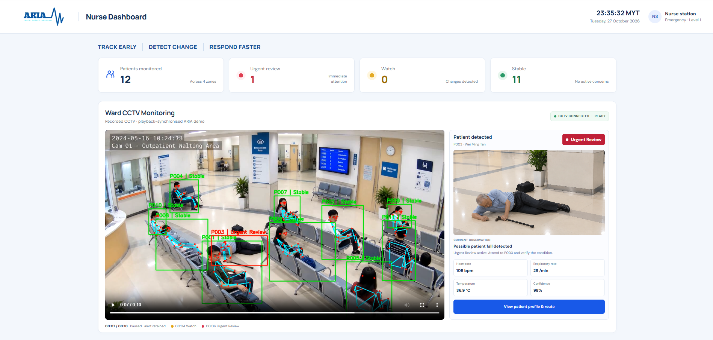

# ARIA - Adaptive Real-Time Intelligence Assessment for Emergency Care

**An intelligent patient-monitoring system concept designed to help
healthcare staff identify changes in patient condition and prioritise
attention.**

ARIA is our project for the **Huawei ICT Competition 2026-2027
Innovation Competition**, presented by **Multimedia University (MMU) +
Brain 404**. We are exploring how patient identification, contactless
sensing, computer vision and intelligent risk assessment could work
together to address a common challenge in healthcare: changes in a
patient's condition may happen between routine nursing observations.

Our aim is to help nurses understand **who needs attention, where the
patient is, and what may be changing in their condition**. ARIA is
designed to complement clinical judgement, not replace it.

## Live Dashboard Demo

**Try the current ARIA nurse dashboard:**
<https://aria-wn0k.onrender.com>

> **Note:** This link opens the current frontend prototype. Some patient
> status changes are simulated using a prerecorded CCTV video; the full
> multi-sensor monitoring system described below is a proposed design
> and is not yet fully implemented.

## Dashboard Preview

## The Problem

In busy emergency departments, observation wards and post-triage waiting
areas, nurses may need to oversee many patients at once. A patient's
condition can change between routine checks, while staff still need to
identify the patient, find their location and decide who needs attention
first.

ARIA focuses on this monitoring gap. The proposed system brings patient
identity, location, movement and physiological observations together so
that concerning changes can be highlighted for human review.

## How ARIA Is Designed to Work

### 1. Patient identification and location

The proposed ARIA smart wristband is intended to associate monitoring
information with the correct patient. Planned features include:

-   RFID/NFC-based patient identification.
-   Bluetooth Low Energy (BLE) zone tracking.
-   QR-code scanning as a fallback for manual identification.
-   Patient location information to help staff find the right person.

### 2. CCTV and contactless sensing

The proposed ARIA contactless multi-sensor pod combines several sensing
methods:

-   **RGB camera and computer vision:** human detection and tracking,
    movement and activity analysis, posture assessment and potential
    fall-event detection.
-   **Thermal sensor:** surface-temperature estimation and
    temperature-trend monitoring.
-   **mmWave radar:** micro-movement analysis, respiration-rate
    estimation and detection of changes in respiration patterns.
-   **Edge AI processing:** local processing of sensor information for
    timely analysis.

These are proposed capabilities. Their accuracy and suitability for
clinical use would need to be tested and validated in realistic
conditions.

### 3. Multi-sensor fusion and risk assessment

ARIA is designed to combine observations rather than rely on one signal
alone. The proposed fusion process associates identity and location with
movement/posture, temperature and respiration observations.
Risk-assessment logic would then classify cases for review.

The intended dashboard categories are:

-   **Stable** - no current concern identified by the system.
-   **Watch** - a change has been identified and should be monitored
    or reviewed.
-   **Urgent Review** - a potentially serious event requires prompt
    human assessment.

These categories support prioritisation; they are not medical diagnoses.

### 4. Nurse dashboard and response workflow

The nurse dashboard is the application layer through which staff would
view patient information and respond to alerts. The current prototype
demonstrates:

-   Patient profiles and status indicators.
-   A patient list and prioritised alerts.
-   CCTV video playback for a demonstration patient.
-   Simulated status changes driven by video playback.
-   Patient location and floor-map information.
-   Route guidance to a patient's location.
-   Alert acknowledgement and reassessment workflow.

## Proposed System Architecture

ARIA is planned as a six-layer system:

| Layer | Intended role |
|---|---|
| Physical layer | Patient identification and zone tracking through wristbands and BLE. |
| Sensing layer | Contactless monitoring using RGB cameras, thermal sensing and mmWave radar. |
| Edge AI layer | Edge intelligence and patient association using the proposed Huawei Atlas platform. |
| Cognitive layer | Multi-sensor fusion, risk assessment and alert generation. |
| Cloud layer | Centralised records, alert history, device connectivity and supporting services. |
| Application layer | Nurse dashboard and clinical response workflow. |

## Proposed Huawei Technology Integration

The presentation explores the following Huawei technologies as possible parts of the wider ARIA architecture:

| Technology | Proposed role |
|---|---|
| Huawei Atlas 200 | Edge AI processing. |
| MindSpore | AI model development and inference. |
| CANN | AI inference acceleration. |
| Huawei IoTDA | Device connectivity and management. |
| Huawei ModelArts | Model training and deployment workflows. |
| Huawei GaussDB | Monitoring records, alerts and historical trends. |
| Huawei FunctionGraph | Event processing, alert routing and workflow automation. |
| Huawei Cloud OBS | Storage for suitable application assets and data. |

These are proposed integrations; the current dashboard has not yet been connected to all these services.

## Current Prototype and Limitations

The current implementation is a frontend dashboard built with **HTML,
CSS and JavaScript**, deployed as a static website on Render. It
demonstrates the dashboard interface and an example alert workflow.

At present:

-   The CCTV footage is prerecorded.
-   Patient status changes for the demonstration are simulated in the
    browser.
-   A live computer-vision detection pipeline is not yet connected to
    the dashboard.
-   The proposed wristband, thermal sensor and mmWave radar are not
    integrated into the working prototype.
-   A central backend and persistent database are not yet implemented.
-   Multiple dashboards do not yet share live patient updates through a
    central service.
-   The system has not been clinically validated.

We distinguish the current prototype from the broader proposed system so
that the implementation status is clear.

## Future Development

Our next development steps are to:

1.  Integrate and test computer vision for human detection, tracking,
    posture analysis and potential fall-event detection.
2.  Explore patient association and location tracking.
3.  Evaluate thermal sensing and mmWave radar for temperature- and
    respiration-related observations.
4.  Develop and validate multi-sensor fusion and risk-assessment logic.
5.  Add a backend and database for persistent patient records and alert
    history.
6.  Support real-time updates across authorised nurse dashboards.
7.  Evaluate suitable Huawei Cloud services for device management, data
    processing and event handling.
8.  Test accuracy, reliability, privacy, usability and false-alarm rates
    before any real clinical use.

## Intended Application

ARIA is initially designed for hospital environments where patients may
need observation between routine assessments, including observation
areas, post-triage waiting areas, recovery areas, step-down care and
general wards.

The broader aim is to support earlier awareness of concerning changes
and help staff prioritise attention more effectively.

## Team

**Project:** ARIA - Adaptive Real-Time Intelligence Assessment for
Emergency Care\
**Competition:** Huawei ICT Competition 2026--2027, Innovation
Competition\
**Institution:** Multimedia University (MMU)\
**Team:** Brain 404

-   **Lim Jia Shyuan**
-   **Lim Jia Qi**
-   **Boo Ming Shun**

**Instructor:** Poh Li Zhe

## Privacy, Safety and Clinical Responsibility

A future implementation would need appropriate access controls, secure
data handling, retention policies, privacy safeguards and compliance
with applicable healthcare requirements. Patient images and identifiable
medical information should not be published in a public repository or
demo.

Computer-generated alerts should be treated as prompts for human review
rather than definitive diagnoses. ARIA is intended to complement
clinical judgement, not replace professional assessment or emergency
procedures.

**ARIA is currently a prototype and research concept. It is not a
clinically validated medical device and should not be used to make real
patient-care decisions.**

------------------------------------------------------------------------

*Track early. Detect change. Respond faster.*
